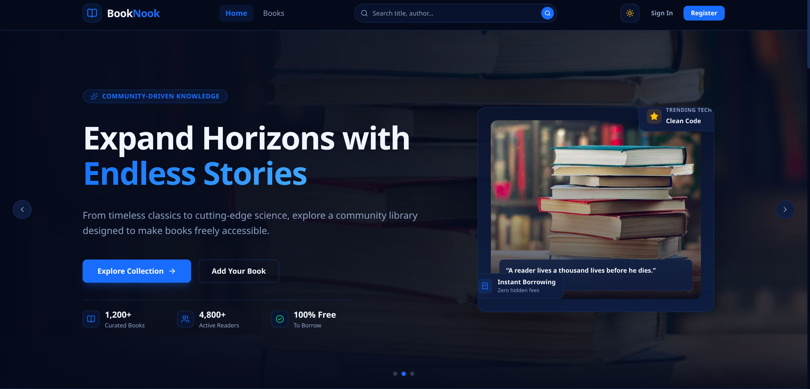

# 📚 BookNook — A Small Online Library

<p align="center">
  
</p>

<p align="center">
  <strong>Discover Books. Share Stories. Keep Reading.</strong>
</p>

<p align="center">
  <a href="https://book-nook-web.vercel.app/">Live Website</a> •
  <a href="https://github.com/shahidul91325/BookNook-Web">Frontend Repository</a> •
  <a href="https://github.com/shahidul91325/BookNook-Backend">Backend Repository</a>
</p>

## 📖 About

BookNook is a small online library platform where readers can explore books, share their own collections, borrow available books, and manage their borrowing activities.

The platform provides a user-friendly experience for discovering books and managing a personal library with secure authentication and real-time inventory tracking.

## ✨ Features

- 🔐 **Authentication:** Secure email/password and Google authentication using Better Auth.
- 📚 **Explore Books:** Browse books with dynamic listings and categories.
- 🆕 **New Arrivals:** Discover recently added books.
- ➕ **Add Books:** Authenticated users can contribute books to the library.
- 📖 **Book Details:** View book information, descriptions, authors, and availability.
- ✏️ **My Books:** Update and delete books added by the logged-in user.
- 🔄 **Borrow & Return:** Borrow available books and return borrowed books.
- 📦 **Inventory Tracking:** Track total and available book copies.
- 👤 **Personalized Dashboard:** Access user-specific books and borrowing records.
- 🌓 **Dark & Light Theme:** Switch between visual themes.
- 📱 **Responsive Design:** Optimized for mobile, tablet, and desktop devices.

## 🛠️ Tech Stack

| Technology         | Purpose                              |
| ------------------ | ------------------------------------ |
| Next.js App Router | Frontend framework                   |
| React              | UI development                       |
| TypeScript         | Type safety                          |
| Tailwind CSS       | Styling                              |
| Better Auth        | Authentication                       |
| MongoDB            | Database integration through backend |
| JWT                | Secure API authorization             |
| Swiper.js          | Homepage slider                      |
| Framer Motion      | Animations                           |
| Sonner             | Toast notifications                  |

## 🚀 Installation

### 1. Clone the repository

```bash
git clone https://github.com/shahidul91325/BookNook-Web.git
cd BookNook-Web
```

### 2. Install dependencies

```bash
npm install
```

### 3. Configure environment variables

Create a `.env.local` file:

```env
NEXT_PUBLIC_API_URL=http://localhost:5000
IMGBB_API_KEY=your_imgbb_api_key
```

`IMGBB_API_KEY` is optional and is required only for book-cover uploads.

### 4. Run the development server

```bash
npm run dev
```

Open http://localhost:3000 in your browser.

## 🔗 Backend Integration

BookNook uses a separate Express.js backend for book management, borrowing operations, inventory tracking, and protected API requests.

**Backend Repository:**  
https://github.com/shahidul91325/BookNook-Backend

Make sure the backend is running and `NEXT_PUBLIC_API_URL` points to the correct API origin.

## 📁 Project Structure

```text
BookNook-Web/
├── app/
├── components/
├── lib/
├── public/
├── proxy.ts
├── next.config.ts
├── package.json
└── README.md
```

## 🔒 Security

- Better Auth manages user authentication.
- JWT is used for protected backend requests.
- Private pages require authentication.
- User-specific resources are protected by backend authorization.
- Backend ownership checks use verified user identity.

## 🌐 Live Demo

Visit the deployed application:

https://book-nook-web.vercel.app/

## 👨‍💻 Developer

**Md. Shahidul Islam**

- GitHub: https://github.com/shahidul91325
- LinkedIn: https://www.linkedin.com/in/shahidul91325/

---

<p align="center">
  Built with ❤️ using Next.js, TypeScript, and MongoDB.
</p>
